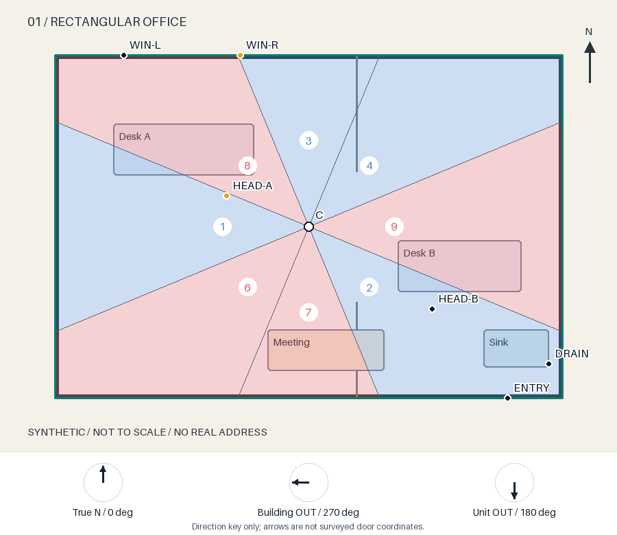

# 风水纳气盘 · 开源版

把原始平面图、明确的门向与取心口径，变成可复算的半透明红蓝分区图。几何由本地Python工具计算，解释保留传统方法的条件和局限。适合需要研究本套方法的布局使用者、教学者和愿意核对参数的Agent；无需真实账户，不上传平面图，不调用外部模型。

[在线Demo](https://songliv66.github.io/fengshui-naqi-pan/) · [三组完整案例](examples/README.md) · [输入契约](references/input-contract.md) · [规则与来源](references/method.md) · [v1.0.0下载](https://github.com/songliv66/fengshui-naqi-pan/releases/tag/v1.0.0)



红6/7/8/9：本方法的纳气区；蓝1/2/3/4：本方法的水位区。颜色不代表已验证的健康、财富或经营结果。几何计算正确，也不构成传统解释有效的科学证明。

## 解决什么问题

- 进门方向、出门方向与门所在角落容易混淆：先统一为向外角度，再算旋转量。
- 不规则平面容易误取图片中心或外包框：默认显示用户确认的主体矩形；面积重心作为明确另选口径。
- 一张静态图难以检查改动：保留JSON坐标与参数指纹，修改方向/中心后重新计算，标明旧结论失效。
- 整体盘、房间盘与个人位置容易混用：头部复核另出图，同一旋转量只平移中心，不擅自更换单元门。

输入是原图PNG/JPEG、真实像素尺寸、单一实际使用轮廓、图纸北向、两道门向、取心理由与标记点。输出是自带底图的SVG、高清度取决于原图的PNG、可离线调透明度的HTML、JSON和可选择文字的Markdown。PNG在原图之外增加120px方向图例，原图比例不变。SVG保留矢量分区，可继续放大。**本版不自动导出PDF、不自动识图，不用生成模型猜精确几何。**

## 五分钟开始

支持Python 3.10+，唯一运行依赖为Pillow；macOS、Windows和Linux可按常规Python环境运行。本次实际验收环境为macOS及Python 3.12.14；其他系统没有实际机测。建议在新目录解压发行包或克隆公开仓库：

```bash
git clone https://github.com/songliv66/fengshui-naqi-pan.git
cd fengshui-naqi-pan
python3 -m venv .venv
source .venv/bin/activate
python3 -m pip install -r requirements.txt
python3 scripts/make_demos.py --out runs/demo-001
```

Windows激活命令为`.venv\Scripts\activate`；如果Python命令为`python`，相应替换`python3`。生成后直接用浏览器打开`runs/demo-001/01-office/overall/overlay.html`，或查看PNG/JSON。断网环境先在有网设备准备Pillow安装包；安装完成后，计算和页面完全离线。

单案例最短命令：

```bash
python3 scripts/render.py examples/01-office/input.json --out runs/office-001
```

输出目录必须不存在，重复运行请换新名字；原图和旧文件不会被覆盖。三组演示总共运行6个视角，每个均实际生成5种文件。仓库的`docs/generated/`包含本次真实运行结果；[静态演示页](docs/index.html)可离线打开，不采集资料、不使用分析脚本或外部模型。

## 作为Skill使用

把仓库根目录作为`fengshui-naqi-pan`放入你的Agent技能目录，确保`SKILL.md`与`scripts/`等资源仍在同一根目录。不同Agent的技能安装位置按各自说明配置；本仓库不修改现有本机Skill，也不要求连接任何私人仓库。

```text
请用 $fengshui-naqi-pan 读取我提供的原始平面图与门向资料。
先核对出门/进门方向、图上真北和主体矩形范围；信息缺失时列待问项。
不要凭图片猜精确几何。确认参数后运行脚本，生成新目录的叠图与JSON，
区分传统规则、图上观察和待现场确认，给下一步调整建议。
```

脚本不负责视觉识别或语言判断；Agent需要实际阅读用户材料并解释。直接运行脚本时，用户自行描录坐标与参数。可复制的完整提示词、原图、核查问答与解释见各示例README。

## 配置和工作流

1. 保留原图尺寸，从实际使用面积连续描点，不把公共走廊、未封阳台或凹口默认补齐。当前仅支持单一无孔轮廓。
2. 填`north_angle`与`building_direction`、`unit_direction`。向外朝向是站在室内看向外；向内值用`sense: inward`由工具加180°。数值若未实测，标`scenario`或`approximate`。
3. 明确`main_rectangle`及理由，或用户明确选择`centroid`。L形的主矩形不是外包框，也未宣称存在唯一传统算法。显式中心用于头部、枕位或有说明的局部复核。
4. 分别标入口、可开窗两端及中间、每个坐者头部、实际排水点。家具名称本身不能代表排水设施。整体红区工位只是候选。
5. 运行并查看PNG/HTML。工具默认3°边界提醒只是绘图阈值；粗估门向的误差可能更大。
6. 改门向、使用轮廓或坐者位置后新建目录重算，传`--previous`保留变化证据。局部盘继承整体旋转量，不擅自用房间门另转一次。

```bash
python3 scripts/render.py examples/03-ambiguous/input.json --out runs/angle-a
python3 scripts/render.py examples/03-ambiguous/direction-6.json --out runs/angle-b --previous runs/angle-a/result.json
```

详见[全部字段与失败条件](references/input-contract.md)。输出目录、透明度、边界阈值、显示裁剪、中心和PNG字体均可配置。示例ASCII标签不依赖外部汉字字体；PNG中文标签需`--font PATH`或`font`字段，用户自行取得分发/使用权；命令行`--font`相对当前目录解析，JSON的`font`相对JSON目录解析。缺字体或依赖时清楚报错，不发布半套结果。

## 三个完整Demo

|案例|输入与追问|实际生成与要点|
|---|---|---|
|[矩形办公室](examples/01-office/README.md)|建筑向外西、进入单元北；核查窗的端点|−90°旋转；整体与HEAD-A移盘；窗跨区，不凭整椅颜色下结论|
|[L形住宅](examples/02-home/README.md)|确认左侧主体矩形，另选面积重心|两种中心分别生成；PILLOW-B归区变化；凹口不染色|
|[歧义与分界](examples/03-ambiguous/README.md)|门向未测，0°/6°两情景|边界警示、HEAD归区变化、旧结论失效和参数指纹|

**披露**：示例原图、参数、模拟用户回答和解释均由作者预写，完全合成。SVG/PNG/HTML/JSON/Markdown是本工具实际运行生成。没有预写模型成绩；使用Agent时，核查、推理和针对新输入的建议仍需要模型执行。页面不接受真实平面图上传。

## 验证与维护

```bash
python3 -m unittest discover -s tests -v
```

当前17个测试覆盖：手算旋转序列、进出方向、图片旋转不变性、面积重心/顶点平均区别、轮廓绕序、中心点、分界、L形与斜凹口跨界矩形、非法图形/标记、裁剪不改计算、像素裁剪、旧文件保护、重算失效、重复JSON键、尺寸不符、缺字体/依赖、离线HTML。测试缓存和本地运行目录不提交。可手动启用的[CI配置示例](references/ci.example.yml)未宣称已在GitHub执行。

[验证范围与局限](VERIFICATION.md)记录实际执行和视觉检查。维护采取问题驱动修复：可复现的计算/文档问题先在合成例中复现，再修订并标版本；不承诺固定更新频率、响应时间或现场咨询服务。

## 已知局限与许可

传统解释不具有本工具已验证的预测效力；未知门向应给条件情景，不得填成实测。没有自动识别墙线、判断主矩形、校正磁偏角或现场量测能力。住宅逐枕位移盘为本Skill应用扩展；整体对照不等于已经完成每个枕位的门窗复核。孔洞、多轮廓、PDF原图、曲墙与精确工程结论超出本版范围。非常窄的显示裁剪会让底部方向图例拥挤。

独立编写代码、文档和合成图采用[MIT](LICENSE)；第三方方法视频、依赖和用户原图不在此授权内。[来源与权利清单](PROVENANCE.md)说明逐项处理。私有来源、原Git历史和本机安装均保持原样。公开版v1.0.0是独立发布，不能当作原私有版1.1.1的替换安装指令。

联系：**puddingvoid**。这是唯一公开联系标识，不推定所属平台。
